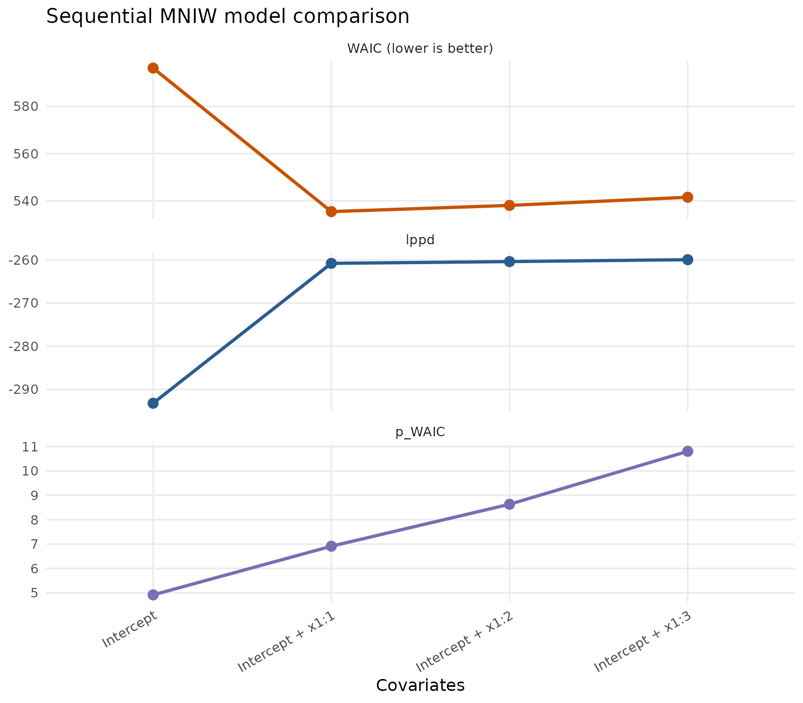

# Analytical and Sample-Based MNIW Model Comparison

This vignette adapts Sudipto Banerjee’s development example on
analytical WAIC for matrix-normal inverse-Wishart (MNIW) multivariate
regression. It uses the installed package and generated data, so it can
run without the development `material/` directory or external data
files.

The workflow fits a conjugate regression, compares analytical scores
with posterior-draw estimates, optionally checks the latter against
`loo`, and compares a sequence of covariate subsets.

## Likelihood and posterior

For an $`n\times q`$ response matrix $`Y`$ and an $`n\times p`$ design
matrix $`X`$, the observations are **independent rows**:

``` math
y_i\mid B,\Sigma \sim N_q(x_i B,\Sigma),\qquad
B\mid\Sigma,D\sim MN(m_n,M_n,\Sigma),\qquad
\Sigma\mid D\sim IW(\nu_n,\Psi_n).
```

Here $`m_n`$ is the actual posterior coefficient mean. In a
precision-based derivation it might instead be written $`M_n a_n`$;
supply that product as `mn`, rather than the unscaled parameter $`a_n`$.

Each response row is one WAIC observation: its $`q`$ response components
are scored jointly. These helpers do not directly score an emulator
whose likelihood has correlated spatial GP rows. Such a model needs its
own likelihood factorization and definition of an observation.

## Fit a multivariate regression

Generate two correlated responses. Only the first covariate has a
nonzero coefficient in the generating model.

``` r

library(spDBL)
set.seed(42)
n <- 120L
X <- cbind(intercept = 1, x1 = seq(-1, 1, length.out = n),
           x2 = rnorm(n), x3 = rnorm(n))
B <- rbind(c(0.8, -0.3), c(1.2, 0.7), c(0, 0), c(0, 0))
Sigma <- matrix(c(0.7, 0.25, 0.25, 0.5), 2)
Y <- X %*% B + matrix(rnorm(2 * n), n, 2) %*% chol(Sigma)
```

Use a zero coefficient prior mean, identity coefficient row covariance,
identity inverse-Wishart scale, and $`q+2`$ prior degrees of freedom.
[`MNIW_R()`](https://xiangchen-stat.github.io/spDBL/reference/MNIW_R.md)
returns all four posterior parameters needed for analytical WAIC. The
identity `H` specifies independent likelihood rows.

``` r

p <- ncol(X)
q <- ncol(Y)
post <- MNIW_R(X, Y, H = diag(n), v = q + 2, S = diag(q),
               C = matrix(0, p, q), Vb = diag(p))
analytical <- compute_analytical_waic(
  Y, X, Mn = post$Vbnew, mn = post$Cnew,
  Psi_n = post$Snew, nu_n = post$vnew)
unlist(analytical[c("WAIC", "lppd", "p_waic")])
#>       WAIC       lppd     p_waic 
#>  541.49264 -259.94080   10.80552
head(analytical$pointwise)
#>           lppd     p_waic elpd_waic     WAIC
#> [1,] -1.854378 0.08479567 -1.939173 3.878346
#> [2,] -2.095335 0.10624721 -2.201582 4.403165
#> [3,] -2.064649 0.06647588 -2.131125 4.262250
#> [4,] -2.016538 0.07003685 -2.086575 4.173150
#> [5,] -2.475828 0.09705290 -2.572881 5.145762
#> [6,] -3.238006 0.17006015 -3.408066 6.816133
```

## Analytical calculation

Define $`h_i=x_iM_nx_i^T`$, $`c_i=1+h_i`$, and
$`d_i=(y_i-x_im_n)\Psi_n^{-1}(y_i-x_im_n)^T`$. The marginal predictive
distribution for one row is multivariate Student t with $`\nu_n-q+1`$
degrees of freedom and scale $`c_i\Psi_n/(\nu_n-q+1)`$. Its log density
gives

``` math
\operatorname{lppd}_i =
\log\Gamma((\nu_n+1)/2)-\log\Gamma((\nu_n-q+1)/2)
-\frac q2\log\pi-\frac12\{q\log c_i+\log|\Psi_n|\}
-\frac{\nu_n+1}{2}\log(1+d_i/c_i).
```

The posterior variance of the row log likelihood is

``` math
p_i=\frac14\left[
\sum_{j=1}^{q}\psi_1((\nu_n-j+1)/2)
+2qh_i^2+4h_i\nu_nd_i+2\nu_nd_i^2-4d_i\right],
```

where $`\psi_1`$ is the trigamma function. The returned totals are

\$\$ \operatorname{lppd}=\sum_i\operatorname{lppd}\_i,\qquad p\_{\rm
WAIC}=\sum_i p_i,\qquad
\operatorname{WAIC}=-2(\operatorname{lppd}-p\_{\rm WAIC}). \$\$

The implementation uses Cholesky factors and triangular solves.
Posterior simulation is unnecessary for these analytical quantities.

## Compare with posterior draws

The imported `mniw` package supplies paired coefficient and covariance
draws. `rMNIW()` uses the coefficient **covariance**
`Sigma = post$Vbnew` with `prec = FALSE`. Its `X` and `V` components are
arrays with dimensions `p x q x S` and `q x q x S`.

``` r

set.seed(123)
draws <- mniw::rMNIW(4000L, Lambda = post$Cnew, Sigma = post$Vbnew,
                     Psi = post$Snew, nu = post$vnew, prec = FALSE)
sampled <- compute_sample_waic(Y, X, draws$X, draws$V,
                               return_log_lik = TRUE)
comparison <- data.frame(
  Method = c("Analytical", "Posterior draws"),
  lppd = c(analytical$lppd, sampled$lppd),
  p_waic = c(analytical$p_waic, sampled$p_waic),
  WAIC = c(analytical$WAIC, sampled$WAIC))
knitr::kable(comparison, digits = 3)
```

| Method          |     lppd | p_waic |    WAIC |
|:----------------|---------:|-------:|--------:|
| Analytical      | -259.941 | 10.806 | 541.493 |
| Posterior draws | -259.945 | 10.806 | 541.503 |

The analytical calculation is exact for the supplied MNIW posterior.
Draw-based estimates have Monte Carlo error. Both functions use the same
row-level likelihood, and
[`compute_sample_waic()`](https://xiangchen-stat.github.io/spDBL/reference/compute_sample_waic.md)
uses sample variances with denominator $`S-1`$.

### Optional comparison with loo

The returned `log_lik` matrix has draws in rows and observations in
columns. `loo` is optional; it is not needed to compute either spDBL
score.

``` r

if (requireNamespace("loo", quietly = TRUE)) {
  reference <- loo::waic(sampled$log_lik)
  comparison <- rbind(comparison, data.frame(
    Method = "loo (same draws)",
    lppd = reference$estimates["elpd_waic", "Estimate"] +
      reference$estimates["p_waic", "Estimate"],
    p_waic = reference$estimates["p_waic", "Estimate"],
    WAIC = reference$estimates["waic", "Estimate"]))
  knitr::kable(comparison, digits = 3)
}
#> Warning: 
#> 3 (2.5%) p_waic estimates greater than 0.4. We recommend trying loo instead.
```

| Method           |     lppd | p_waic |    WAIC |
|:-----------------|---------:|-------:|--------:|
| Analytical       | -259.941 | 10.806 | 541.493 |
| Posterior draws  | -259.945 | 10.806 | 541.503 |
| loo (same draws) | -259.945 | 10.806 | 541.503 |

The two calculations using identical draws should agree up to numerical
precision. `loo` can warn about large pointwise WAIC penalties. Its
authors recommend PSIS leave-one-out cross-validation for the additional
diagnostics; the same `sampled$log_lik` can be supplied to
[`loo::loo()`](https://mc-stan.org/loo/reference/loo.html).

## Compare sequential covariate subsets

Refit each subset using its corresponding prior. Keep the responses and
the definition of an observation fixed across comparisons.

``` r

profile <- do.call(rbind, lapply(seq_len(p), function(k) {
  X_k <- X[, seq_len(k), drop = FALSE]
  fit <- MNIW_R(X_k, Y, H = diag(n), v = q + 2, S = diag(q),
                C = matrix(0, k, q), Vb = diag(k))
  score <- compute_analytical_waic(Y, X_k, fit$Vbnew, fit$Cnew,
                                   fit$Snew, fit$vnew)
  data.frame(Model = if (k == 1L) "Intercept" else
    paste0("Intercept + x1:", k - 1L),
    lppd = score$lppd, p_waic = score$p_waic, WAIC = score$WAIC)
}))
knitr::kable(profile, digits = 3)
```

| Model            |     lppd | p_waic |    WAIC |
|:-----------------|---------:|-------:|--------:|
| Intercept        | -293.209 |  4.918 | 596.253 |
| Intercept + x1:1 | -260.788 |  6.912 | 535.400 |
| Intercept + x1:2 | -260.383 |  8.634 | 538.033 |
| Intercept + x1:3 | -259.941 | 10.806 | 541.493 |

``` r

metrics <- c("WAIC", "lppd", "p_waic")
labels <- c("WAIC (lower is better)", "lppd", "p_WAIC")
long <- do.call(rbind, lapply(seq_along(metrics), function(j)
  data.frame(Model = profile$Model, Metric = labels[j],
             Value = profile[[metrics[j]]])))
long$Model <- factor(long$Model, levels = profile$Model)
long$Metric <- factor(long$Metric, levels = labels)
colors <- stats::setNames(c("#c85200", "#2b5c8f", "#7570b3"), labels)
ggplot2::ggplot(long, ggplot2::aes(Model, Value, color = Metric, group = Metric)) +
  ggplot2::geom_line(linewidth = 1.1) +
  ggplot2::geom_point(size = 3) +
  ggplot2::facet_wrap(~Metric, ncol = 1, scales = "free_y") +
  ggplot2::scale_color_manual(values = colors) +
  ggplot2::theme_minimal(base_size = 12) +
  ggplot2::theme(legend.position = "none",
    axis.text.x = ggplot2::element_text(angle = 30, hjust = 1),
    panel.grid.minor = ggplot2::element_blank()) +
  ggplot2::labs(title = "Sequential MNIW model comparison",
                x = "Covariates", y = NULL)
```



Lower WAIC favors a model’s estimated predictive performance among these
candidates. Neither lppd nor the effective-parameter penalty is
guaranteed to increase monotonically with added covariates. The minimum
is a comparative estimate, not a guarantee that the selected subset is
the true model.

## References

Watanabe, S. (2010). Asymptotic equivalence of Bayes cross validation
and widely applicable information criterion in singular learning theory.
*Journal of Machine Learning Research*, **11**, 3571–3594.

Vehtari, A., Gelman, A., and Gabry, J. (2017). Practical Bayesian model
evaluation using leave-one-out cross-validation and WAIC. *Statistics
and Computing*, **27**, 1413–1432.

The [loo WAIC
documentation](https://mc-stan.org/loo/reference/waic.html) describes
its likelihood-array conventions and interpretation.
